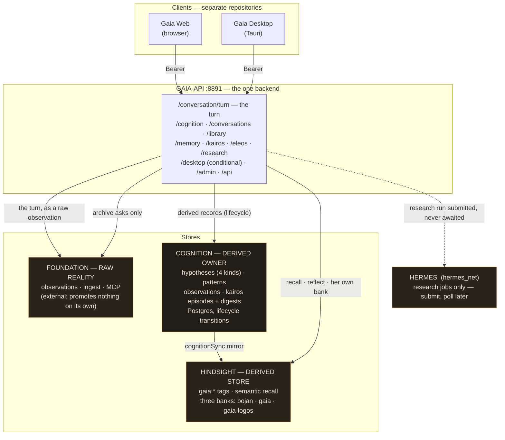
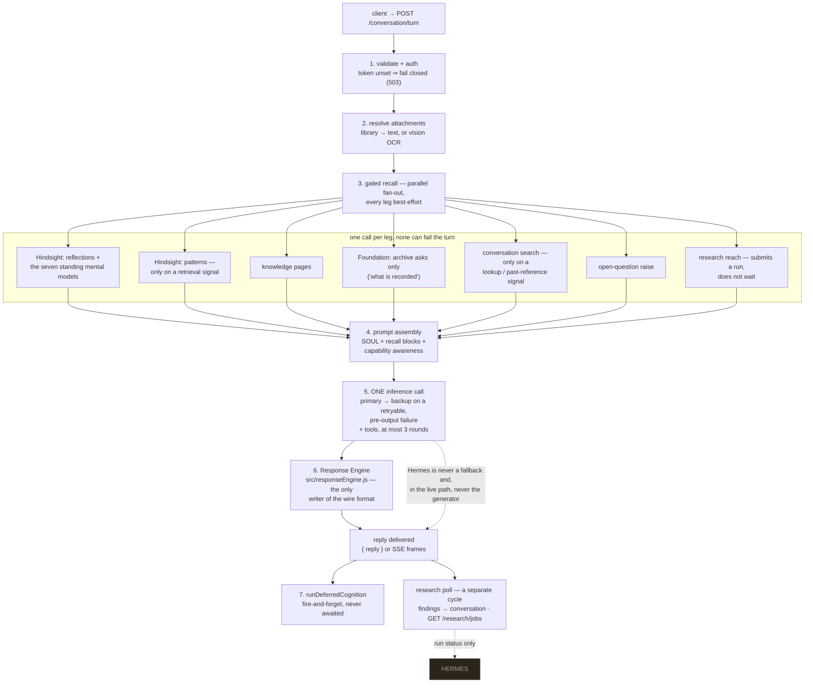
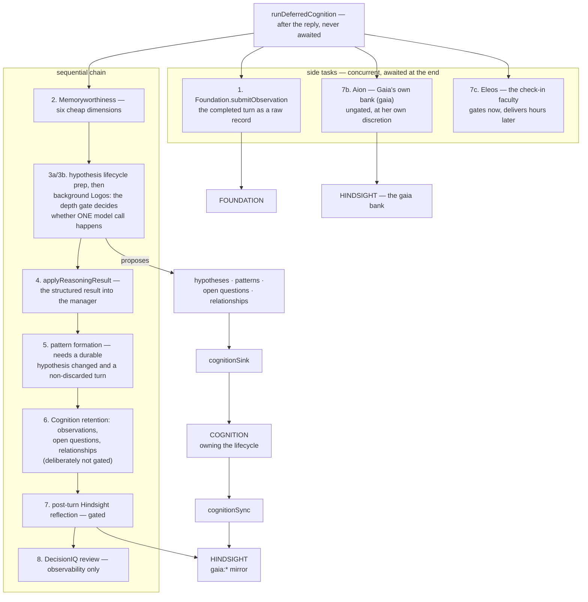
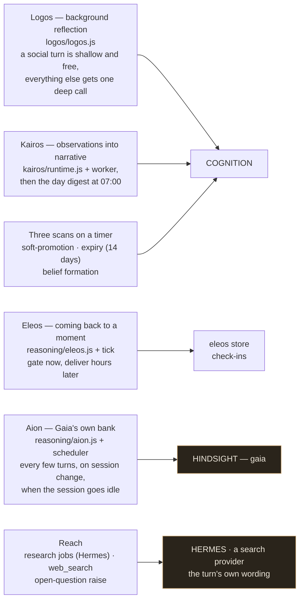
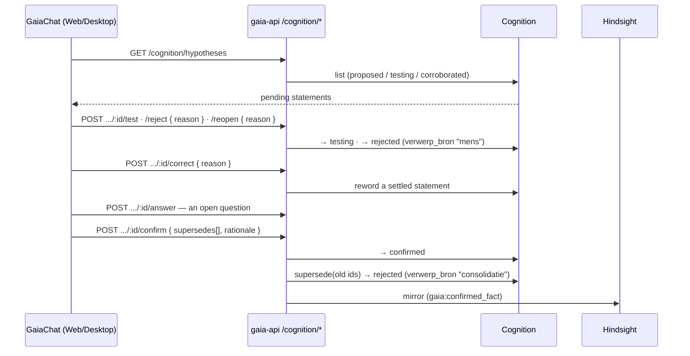
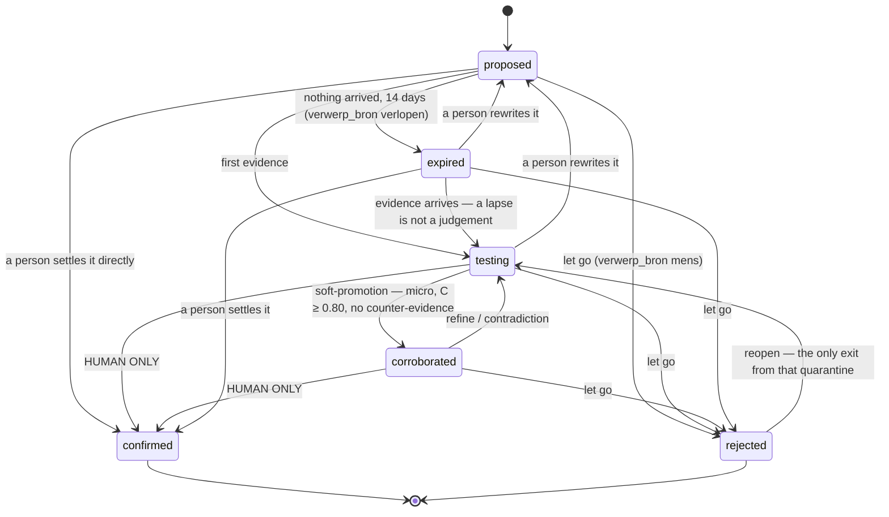
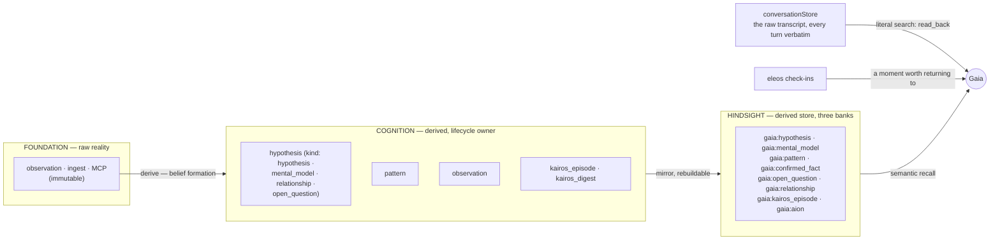

# Gaia-Cloud — how everything is connected

A visual map of the current system: the three stores, the live turn, the deferred cognition
that writes, the faculties, the human Absolute Override, and the surface a client reaches.

> Renders on GitHub natively (Mermaid). A standalone, zoomable version lives in
> `docs/architecture-graph.html`.
>
> Regenerated 2026-11-16 against `a1a485e`. Every claim below is a shortened form of
> `docs/architecture.md`, which is machine-checked by `scripts/verify-architecture.js`; where
> the two ever disagree, that document wins.

## 1. The whole system

## 2. The live turn — direct generation

## 3. The tools inside that one call

| Tool | Where | Gated by |
| --- | --- | --- |
| `remember` → `bojan`, `keep` → `gaia`, `search_memory`, `retract_memory`, `forget_memory` | `reasoning/memoryTool.js` | `GAIA_MEMORY_TOOL` (one flag for all five) |
| `web_search` | `reasoning/webSearchTool.js` | presence of `GAIA_WEB_SEARCH_API_KEY` |
| `read_back` | `reasoning/conversationTool.js` | the transcript seam being wired |
| `desktop` | `desktopBroker.js` | `GAIA_DESKTOP` + client `desktop: true` + streamed turn |

Three *rounds* is the bound, not three calls: every call inside a round runs
(`generation/gaiaGenerator.js`, `DEFAULT_MAX_TOOL_ROUNDS = 3`). There is no tool named
`conversation_search` — that is the capability id, and `read_back` is the tool behind it.

## 4. Deferred cognition — where writing happens

## 5. The faculties — loops with no turn involved

Belief formation is the **only** thing that forms a statement from observations, and it needs
repeated ground. Per-turn hypothesis formation is off by default (Optie 2);
`GAIA_HYPOTHESIS_FORMATION=per_turn` restores the old behaviour.

## 6. Human Absolute Override — the only path to `confirmed`

## 7. The lifecycle — six statuses

`expired` deletes nothing and quarantines nothing. `verwerp_bron` has three values: `mens`,
`consolidatie` (a newer statement superseded it, with a `superseded_by_id` pointer) and
`verlopen` (the machine's own lapse reason, kept apart because nothing was judged).
`corroborated` may inform retrieval; it is never presented as settled.

## 8. What lives where

Two rules that are easy to get wrong. **The notebook is not memory**: `conversationStore` saves
every turn verbatim, and it is neither Hindsight nor Cognition. And **per-turn recall does not
span all three banks**: an ordinary turn fills its recall lines from `bojan` alone, `gaia`
joins only when the turn asks about her, `gaia-logos` takes no lines of its own, and the *full*
cross-bank client is what `search_memory` uses.

## 9. The HTTP surface

| Mount | Routes |
| --- | --- |
| inline | `GET /health`, `GET /`, `GET /soul`, `POST /conversation/turn` (JSON or SSE), `GET /speech/info`, `GET /speech/stt-info`, `POST /speech`, `POST /speech/stream`, `POST /speech/transcribe` |
| `/library` | `POST /files`, `GET /files`, `GET /files/:id`, `DELETE /files/:id` |
| `/conversations` | `GET /`, `GET /events` (SSE), `GET /search?q=`, `GET /:id`, `GET /:id/export/:format`, `DELETE /:id` |
| `/cognition` | `GET /hypotheses`, `POST /hypotheses/:id/{test,reject,reopen,correct,answer,confirm}` |
| `/memory` | `POST /retract`, `POST /forget` |
| `/kairos` | `GET /episodes`, `GET /episodes/stream` (SSE), `GET /episodes/:id/evidence`, `GET /digests`, `GET /digest?date=`, `POST /digest` |
| `/eleos` | `GET /checkins`, `POST /checkins/:id/ack` |
| `/research` | `GET /jobs`, `POST /jobs/:id/ack`, `POST /jobs/:id/approval` |
| `/desktop` | `POST /actions/:id/decision`, `POST /actions/:id/result` — only when `GAIA_DESKTOP` is on |
| `/admin` | operator-only, ~30 API routes; its HTML shell (`GET /admin`) is unauthenticated |
| `/api` | `GET /version` — public, no auth |

Cognition's own service speaks
`POST|GET|PATCH|DELETE /v1/banks/:bankId/{hypotheses,patterns,episodes,observations}`, on the
tailnet and unauthenticated. Clients never reach it directly.

## The three boundaries

1. **Foundation = raw reality.** A client that claims a `status` is refused (422).
   Observations only, and the store promotes nothing to fact by itself.
2. **Cognition = the lifecycle owner.** It stores and books transitions; it never reasons.
   Logos proposes, belief formation forms statements from repeated ground, and the person
   settles them.
3. **Hindsight = the derived store.** Rebuildable from Cognition with provenance, and recall
   lives there because Cognition has no vector search.
